# Manual de uso de SelahFinance

**Administra con propósito, vive con libertad.**

SelahFinance es una aplicación para el celular que te ayuda a cuidar tu dinero y tu vida como un buen mayordomo, con la mirada de las cuatro áreas de la mayordomía adventista: **Tiempo, Talento, Tesoro y Templo**. No necesitas saber de finanzas ni de tecnología: este manual te lleva paso a paso, con imágenes de la propia aplicación.

> **Versión de pruebas.** Usa datos de ejemplo o que no te importe compartir con el equipo del proyecto. Las pantallas de este manual usan datos ficticios.

## ¿Qué parte me toca leer?

La aplicación tiene **tres tipos de usuario**. Lee la Parte A (todos) y la parte de tu rol:

| Rol | Para quién es | Qué hace | Lee |
|---|---|---|---|
| **Hermano** | Cualquier miembro de la iglesia | Lleva sus finanzas, hábitos y reportes personales | Partes A y B |
| **Pastor** | Quien pastorea una iglesia | Todo lo del hermano **y además** ve un resumen anónimo de su congregación y los reportes de quienes decidan compartirlos | Partes A, B y C |
| **Administrador** | Quien gestiona la aplicación | Crea y bloquea cuentas, registra iglesias y da acceso a otros sistemas. **No ve dinero de nadie** | Partes A y D |

## Contenido

- **Parte A · Para todos:** 1. Instalar la aplicación · 2. Crear tu cuenta y entrar · 3. Configuración inicial
- **Parte B · Hermano:** 4. Inicio · 5. Movimientos · 6. Diezmos y ofrendas · 7. Metas y deudas · 8. Reportes · 9. Hábitos y reflexión · 10. Avisos · 11. Perfil y privacidad
- **Parte C · Pastor:** 12. Mi congregación
- **Parte D · Administrador:** 13. Panel de administración
- **Parte E · Ayuda:** 14. Preguntas frecuentes · 15. Pequeño diccionario

---

# Parte A · Para todos

## 1. Instalar la aplicación (Android)

La aplicación se entrega como un archivo **APK** (el instalador para Android). Alguien del equipo te compartirá un enlace (Drive, WhatsApp, etc.).

1. Abre el enlace desde tu celular y **descarga** el archivo (termina en `.apk`).
2. Al abrirlo, Android puede decir *«Por seguridad, tu teléfono no permite instalar apps de esta fuente»*. Toca **Configuración** y activa **«Permitir de esta fuente»** (o «Instalar apps desconocidas») para la app desde la que lo abriste (Drive, Chrome, WhatsApp…). Es normal en apps de prueba. Luego vuelve atrás.
3. Toca **Instalar**. Si aparece un aviso de *Play Protect*, elige **«Instalar de todos modos»**.
4. Toca **Abrir**. Quedará un ícono de **SelahFinance** en tu pantalla.

Necesitas **conexión a internet** (datos móviles o Wi-Fi). Solo funciona en **Android**.

> **Si la primera vez tarda en cargar:** espera hasta un minuto y vuelve a intentar. El servidor de pruebas «despierta» tras un rato sin uso.

## 2. Crear tu cuenta y entrar

### La introducción
La primera vez que abres la app ves tres pantallas con la idea de fondo. Toca **Siguiente** y, en la última, **Comenzar** (o **Omitir** arriba a la derecha).

<figure>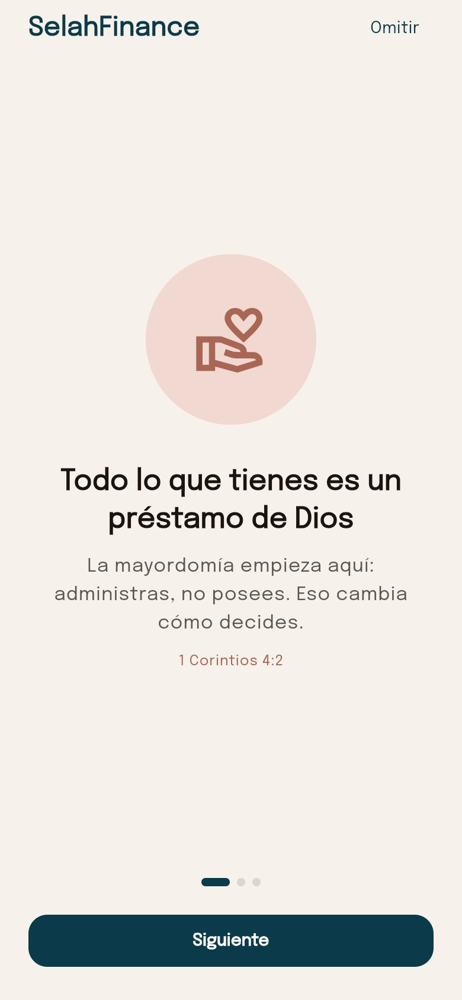<figcaption>1. Todo es un préstamo de Dios</figcaption></figure><figure>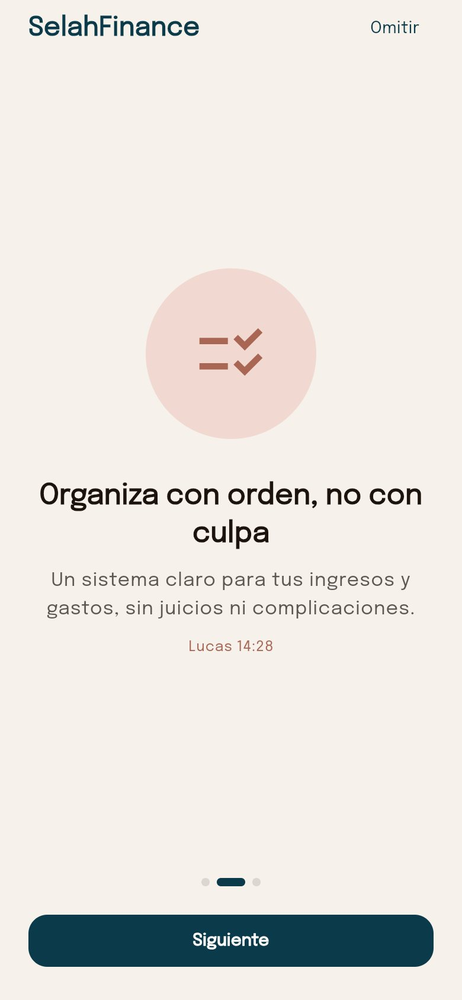<figcaption>2. Orden, no culpa</figcaption></figure><figure>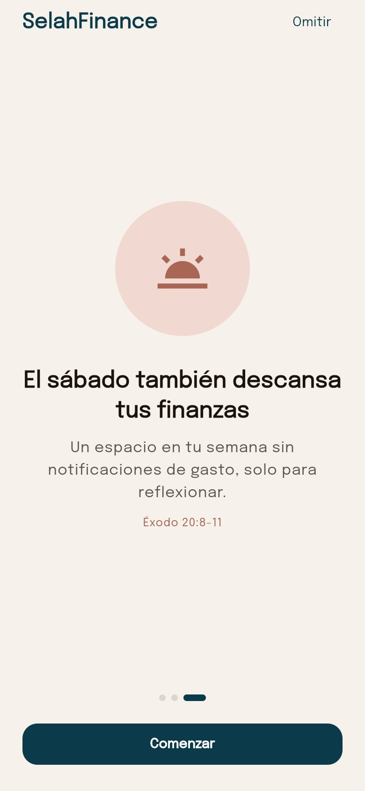<figcaption>3. El sábado también descansan tus finanzas</figcaption></figure>

### Si eres nuevo: crear una cuenta
1. En la pantalla de ingreso, toca **«Soy nuevo: crear una cuenta»**.
2. Completa **Nombre**, **Apellidos** (opcional), **Email** y **Contraseña** (mínimo 8 caracteres).
3. En **Mi iglesia** elige tu iglesia de la lista.
4. Toca **Crear cuenta**. Entrarás directo a la app.

<figure>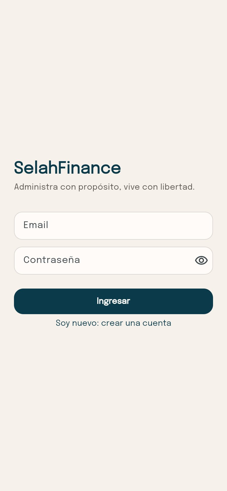<figcaption>Pantalla de ingreso</figcaption></figure><figure>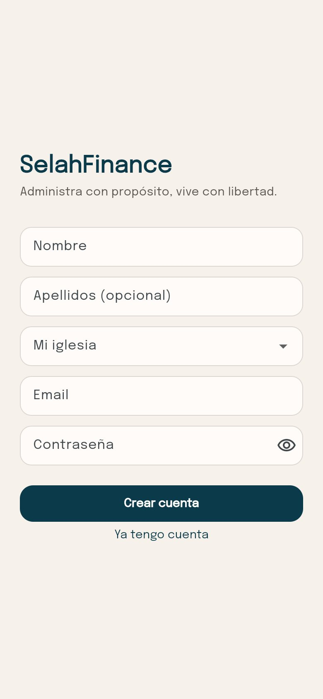<figcaption>Registro de cuenta nueva</figcaption></figure><figure>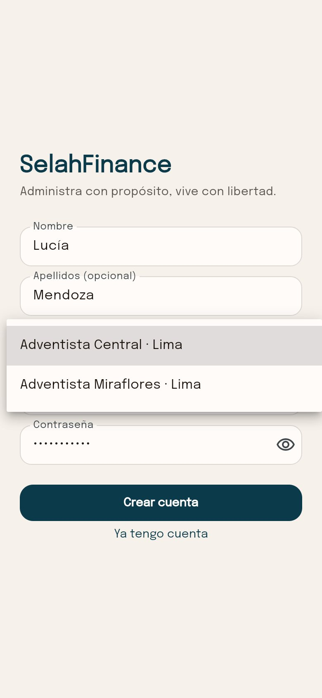<figcaption>Elegir mi iglesia</figcaption></figure>

> **¿Tu iglesia no aparece en la lista?** Pídele al administrador que la registre (ver Parte D).

### Si ya tienes cuenta
Escribe tu **Email** y tu **Contraseña** y toca **Ingresar**. El ícono del ojo muestra u oculta la contraseña.

### Si el administrador creó tu cuenta (pastores y otros)
Te entregará un email y una **contraseña temporal**. Al entrar por primera vez, la app te pedirá **elegir una contraseña nueva** (mínimo 8 caracteres, repetida dos veces) antes de continuar.

### Si olvidaste tu contraseña
Por ahora no hay recuperación automática. Pide al **administrador** que te asigne una contraseña temporal nueva y cámbiala al entrar.

## 3. Configuración inicial (asistente)

La primera vez, un asistente de **4 pasos** prepara la app para ti. Tarda unos minutos y puedes cambiarlo todo después.

1. **Bienvenido:** una breve introducción.
2. **Tus ingresos:** agrega tus fuentes de ingreso con un monto mensual aproximado (por ejemplo, *Salario — S/ 2 500*).
3. **Tu mayordomía:** elige qué porcentaje apartas para el **diezmo** (por defecto 10 %) y la **ofrenda** (por defecto 2 %), y el día del mes en que sueles entregarlo.
4. **Tus gastos:** la app propone categorías (Vivienda, Alimentación, Transporte…). Quita las que no uses, agrega las tuyas y pon un **presupuesto mensual** a cada una.

<figure>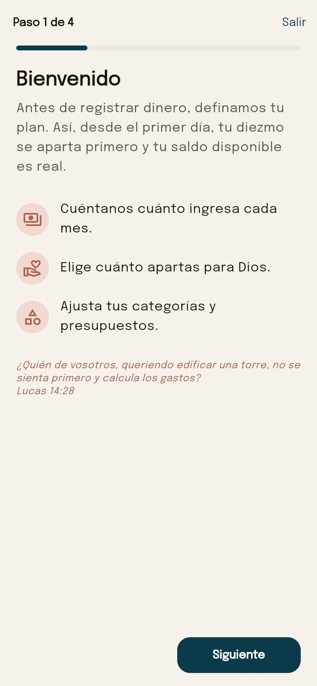<figcaption>Paso 1 · Bienvenido</figcaption></figure><figure>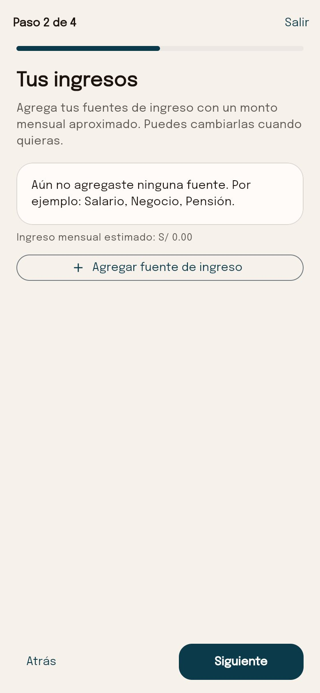<figcaption>Paso 2 · Tus ingresos</figcaption></figure><figure>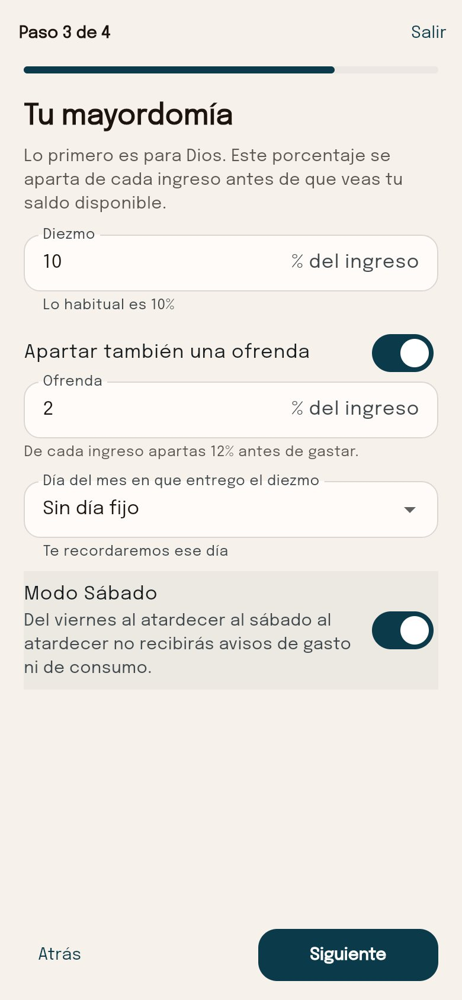<figcaption>Paso 3 · Tu mayordomía</figcaption></figure><figure>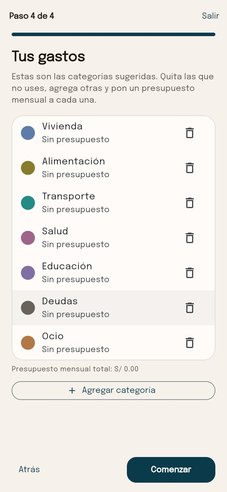<figcaption>Paso 4 · Tus gastos</figcaption></figure>

Con **Atrás** vuelves un paso. Si tocas **Salir**, cierras sesión; al volver a entrar, el asistente te espera para terminarlo. **El administrador no pasa por este asistente**, porque no maneja finanzas.

---

# Parte B · Hermano

Todo lo de esta parte también lo puede hacer el **pastor**, que tiene sus propias finanzas como cualquier hermano.

## 4. Inicio

Es tu resumen de un vistazo. Abajo tienes cinco pestañas: **Inicio, Movimientos, Diezmos, Metas y Reportes**. Arriba a la derecha están la **campana** (avisos) y tu **inicial** (perfil). Para actualizar los datos, desliza hacia abajo.

<figure>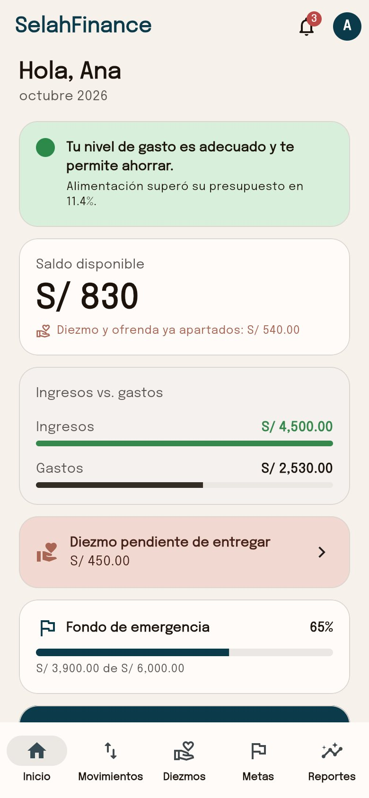<figcaption>Inicio: semáforo, saldo y diezmo pendiente</figcaption></figure><figure>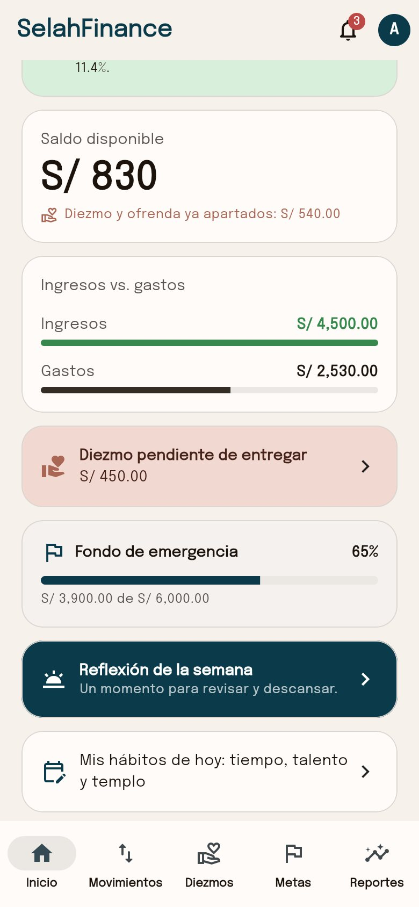<figcaption>Más abajo: meta, reflexión y hábitos</figcaption></figure>

- **El semáforo:** un mensaje con color que te dice cómo vas.
  - 🟢 **Verde:** tus gastos y pagos de deuda están por debajo del 70 % de lo que ganas.
  - 🟡 **Amarillo:** entre 70 % y 90 %. Cuidado.
  - 🔴 **Rojo:** más del 90 %. Es momento de ajustar.
  - También te dice qué categoría se pasó (por ejemplo, *«Alimentación superó su presupuesto en 11,4 %»*).
- **Saldo disponible:** lo que realmente puedes gastar. Debajo ves *«Diezmo y ofrenda ya apartados»*.
- **Ingresos vs. gastos** del mes.
- **Diezmo pendiente de entregar:** tócalo para ir a entregarlo.
- **Tu meta principal**, la **Reflexión de la semana** y **Mis hábitos de hoy**.

> **La idea principal:** cuando anotas un ingreso, la app **aparta primero** el diezmo y la ofrenda (*«Primero lo de Dios»*, Proverbios 3:9). Lo que ves como **Saldo disponible** ya es lo que puedes usar.

## 5. Movimientos (registrar tu dinero)

Todo lo que entra o sale de tu bolsillo se anota aquí. Es la base de todos los números de la app.

<figure>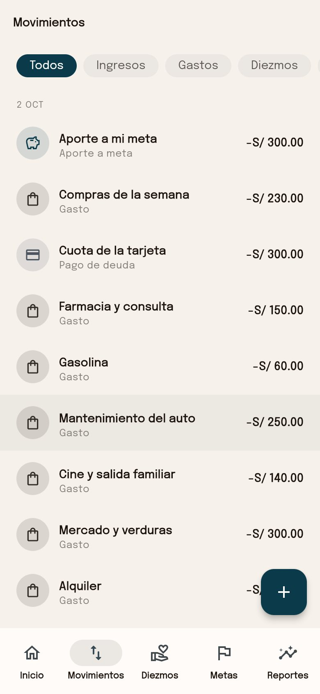<figcaption>Lista de movimientos, con filtros por tipo</figcaption></figure><figure>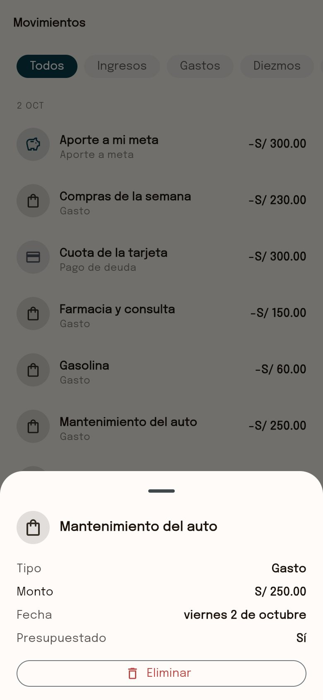<figcaption>Detalle de un movimiento (se puede eliminar)</figcaption></figure>

### Anotar un movimiento
1. Pestaña **Movimientos** → botón **+** (*Nuevo movimiento*).
2. Elige el **tipo**:

| Tipo | Úsalo cuando… |
|---|---|
| **Ingreso** | Recibes dinero (sueldo, venta, regalo). Aquí se aparta automáticamente el diezmo y la ofrenda. |
| **Gasto** | Pagas algo (comida, transporte, servicios). Pide **categoría**. |
| **Diezmo / Ofrenda** | Entregas tu diezmo u ofrenda (mejor hazlo desde la pestaña *Diezmos*). |
| **Pago de deuda** | Pagas una cuota. Pide **qué deuda**. |
| **Aporte a meta** | Guardas dinero para una meta. Pide **a qué meta**. |

3. Escribe el **Monto** (en soles, S/) y revisa la **Fecha** (por defecto, hoy).
4. Si es un gasto, elige la **Categoría**; marca *«Fue un gasto imprevisto»* si no lo tenías presupuestado.
5. Toca **Guardar**.

<figure>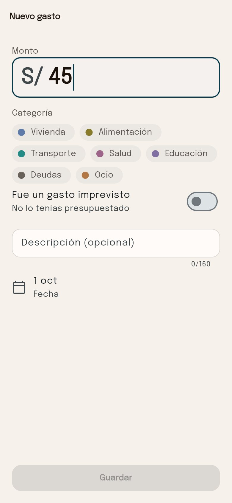<figcaption>Nuevo gasto: monto y categoría</figcaption></figure><figure>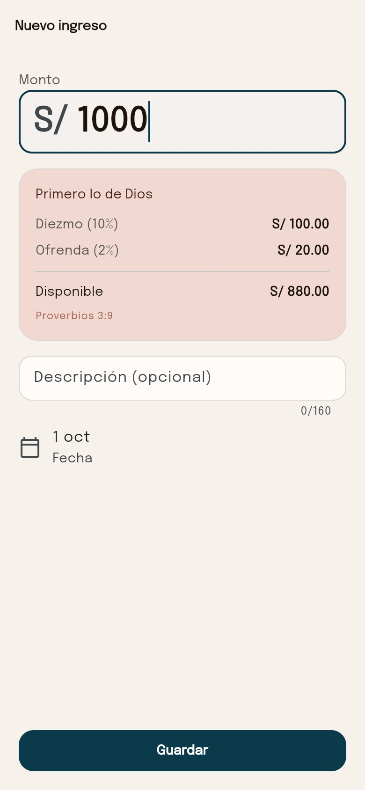<figcaption>Nuevo ingreso: la app muestra lo que aparta para Dios</figcaption></figure>

Al guardar, **todo se actualiza solo**: tu saldo, el semáforo, tus metas y tus reportes. Si te equivocas, toca el movimiento y **Eliminar**; los números se corrigen solos (por ejemplo, al borrar un pago de deuda, la deuda vuelve a su saldo anterior).

## 6. Diezmos y ofrendas

Pestaña **Diezmos**. Aquí ves cuánto has apartado y entregado.

<figure>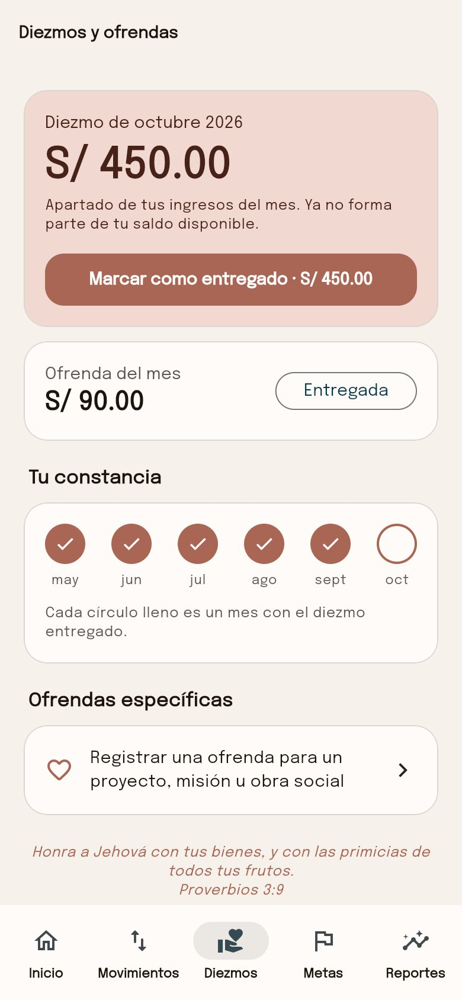<figcaption>Diezmo del mes y botón de entrega</figcaption></figure><figure>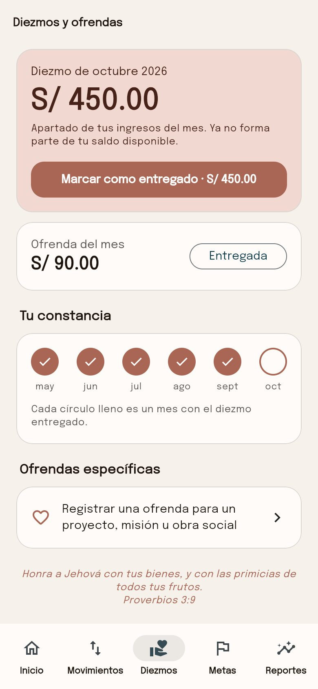<figcaption>Constancia de 6 meses y ofrendas específicas</figcaption></figure>

- **Marcar como entregado · S/ …:** tócalo **después de entregar tu diezmo** en tu iglesia. El pendiente desaparece de Inicio. La app no sabe si entregaste hasta que lo marcas.
- **Tu constancia:** *cada círculo lleno es un mes con el diezmo entregado.*
- **Registrar una ofrenda para un proyecto, misión u obra social:** para ofrendas especiales adicionales.

Tu saldo disponible **no baja dos veces**: el diezmo se descuenta desde que el ingreso entra, no cuando lo entregas. Puedes cambiar los porcentajes y el día de entrega en **Perfil → Mayordomía**.

## 7. Metas de ahorro y deudas

Pestaña **Metas**, con dos secciones: **Ahorros** y **Deudas**.

<figure>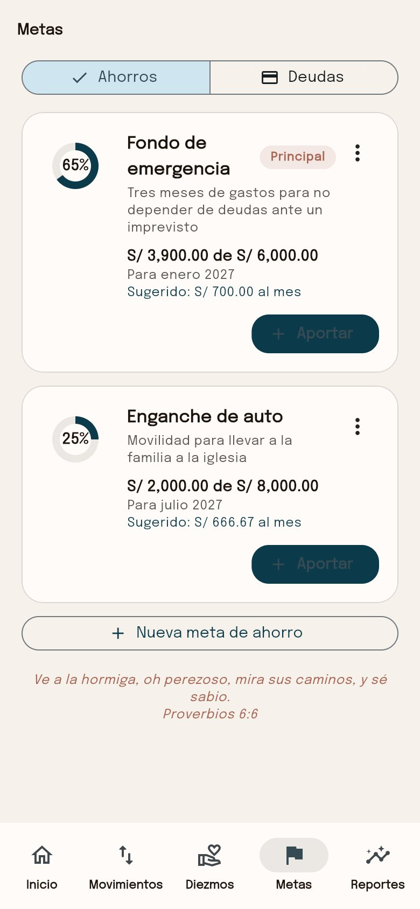<figcaption>Metas de ahorro y su avance</figcaption></figure><figure>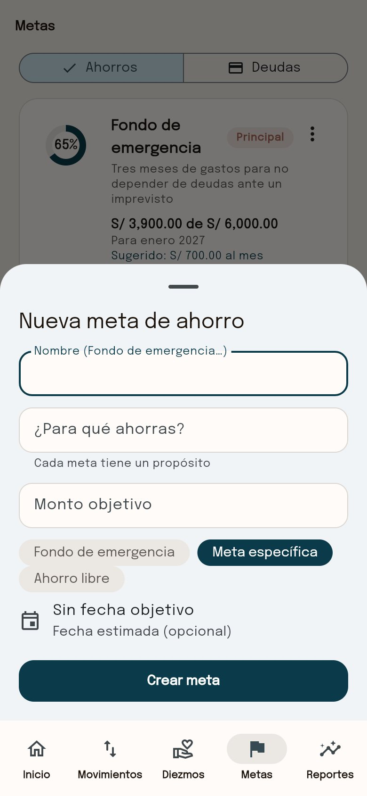<figcaption>Crear una meta de ahorro</figcaption></figure><figure>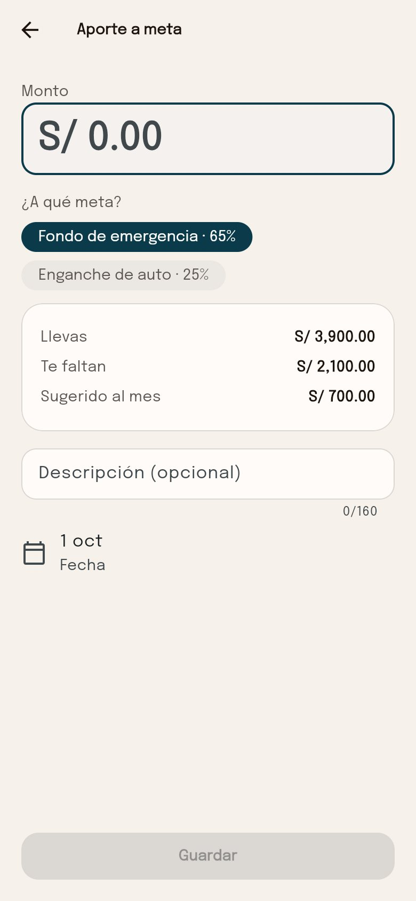<figcaption>Aportar a una meta</figcaption></figure>

### Metas de ahorro
1. Toca **Nueva meta de ahorro**.
2. Escribe el **nombre**, **¿para qué ahorras?** (*cada meta tiene un propósito*), el **monto objetivo** y, si quieres, una **fecha estimada**. Elige si es *Fondo de emergencia*, *Meta específica* o *Ahorro libre*.
3. Toca **Crear meta**.

En cada meta puedes **Aportar**, **Hacer principal** (la que se destaca en Inicio) o **Cancelar meta**. La app calcula el **aporte mensual sugerido** para llegar a tiempo.

### Deudas
1. En la sección **Deudas** toca **Registrar una deuda**.
2. Completa nombre, a quién le debes, monto original, lo que debes hoy, tasa anual, meses restantes y día de pago (opcional). **La cuota mensual se calcula sola.**
3. Para pagar: **Registrar pago**. En cada pago, **primero se cubren los intereses del mes y el resto baja tu saldo**.

<figure>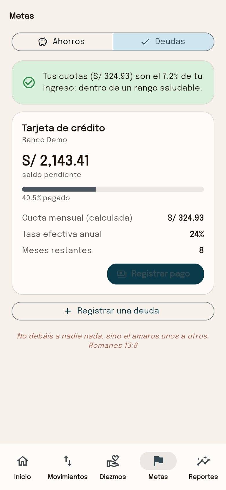<figcaption>Deudas: saldo, cuota y meses restantes</figcaption></figure><figure>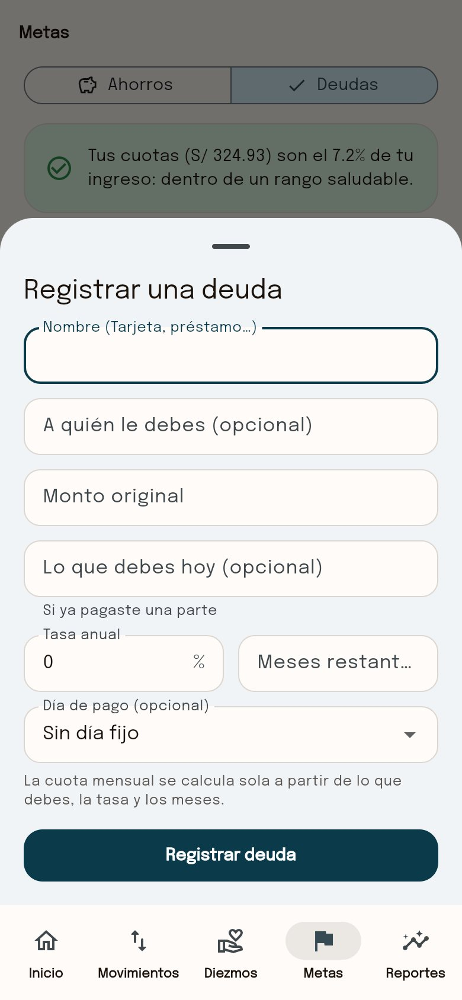<figcaption>Registrar una deuda</figcaption></figure>

La app te avisa si tus cuotas pasan del **40 % de tus ingresos** (señal de sobreendeudamiento).

## 8. Reportes

Pestaña **Reportes**, con dos vistas. Las flechas **‹ ›** junto al mes te llevan a meses anteriores.

### Finanzas
El semáforo del mes, tres porcentajes (**Gasto**, **Deuda** y **Ahorro**, sobre tus ingresos) y el cuadro **Presupuestado vs. real** por categoría, con el porcentaje de diferencia (rojo si te pasaste).

<figure>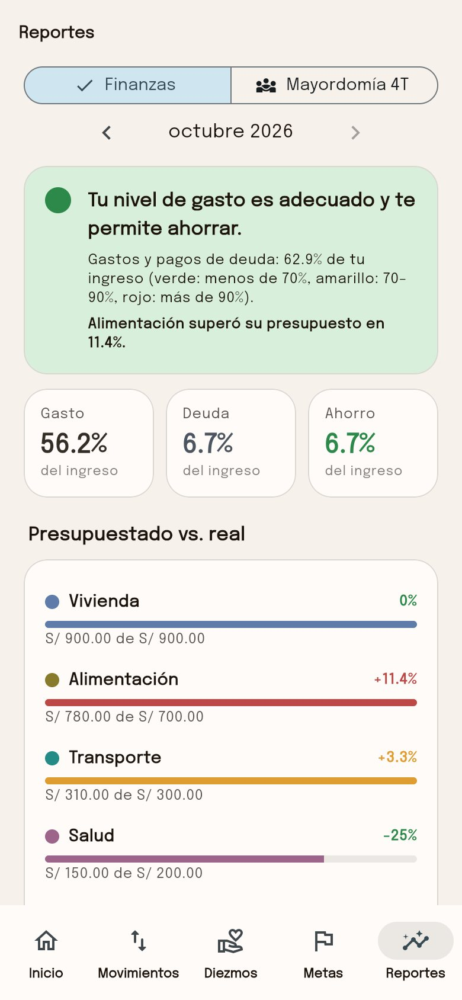<figcaption>Resumen financiero del mes</figcaption></figure><figure>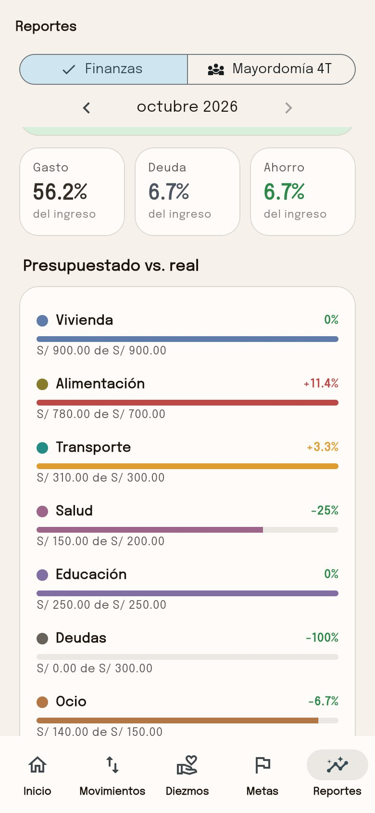<figcaption>Presupuestado vs. real por categoría</figcaption></figure>

### Mayordomía 4T
Un puntaje de **0 a 100** por área y uno **integral**. Es **una guía para crecer, no una calificación**. Toca la flechita de cada área para ver los **hábitos** que la forman. Verde: 75 o más · Amarillo: 50 a 74 · Rojo: menos de 50. Si no registraste nada en un área ese mes, no te penaliza.

<figure>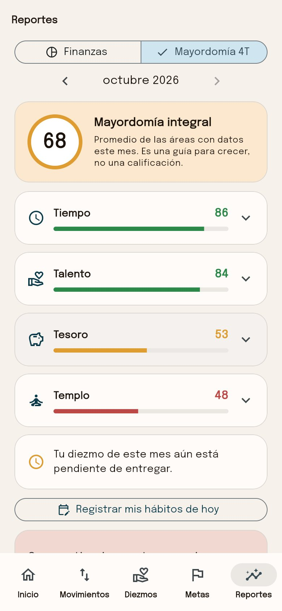<figcaption>Mayordomía integral y sus cuatro áreas</figcaption></figure><figure>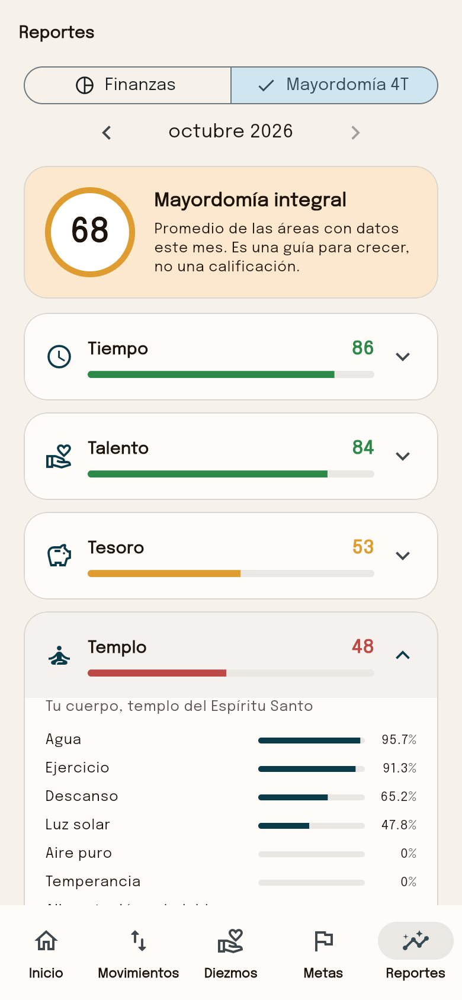<figcaption>Detalle de «Templo» (hábitos de salud)</figcaption></figure>

| Área | Qué mide |
|---|---|
| **Tiempo** | Culto personal, estudio bíblico, culto familiar, asistencia a la iglesia, el sábado como día de descanso |
| **Talento** | Servicio en la iglesia, ayuda a los demás, desarrollo de tus dones |
| **Tesoro** | Fidelidad en el diezmo, control del gasto, ahorro y salud de tus deudas (se calcula solo con tus finanzas) |
| **Templo** | Cuidado de tu cuerpo: agua, ejercicio, descanso, sol, aire puro, temperancia, alimentación y confianza en Dios |

Al final de esta pantalla está el interruptor para **compartir tu reporte con tu pastor** (ver sección 11).

## 9. Hábitos y reflexión semanal

### Mis hábitos de hoy
Se abre desde la tarjeta de **Inicio** o desde tu perfil. Los de **sí/no** (por ejemplo, *culto familiar*) se marcan con el interruptor; los de **cantidad** (por ejemplo, *minutos de culto personal*) se ajustan con **–** y **+**. Cada uno muestra su meta, tu avance y, muchas veces, un **versículo bíblico**. Lo que anotas alimenta tu reporte **Mayordomía 4T**.

### Reflexión de la semana
Es el único momento de la app pensado para **no hacer nada, solo mirar**: aparece desde el **viernes a las 15:00 hasta el sábado**. Te muestra cuánto entró y salió en la semana y una pregunta para pensar. Puedes escribir tu reflexión (opcional) y guardarla.

<figure>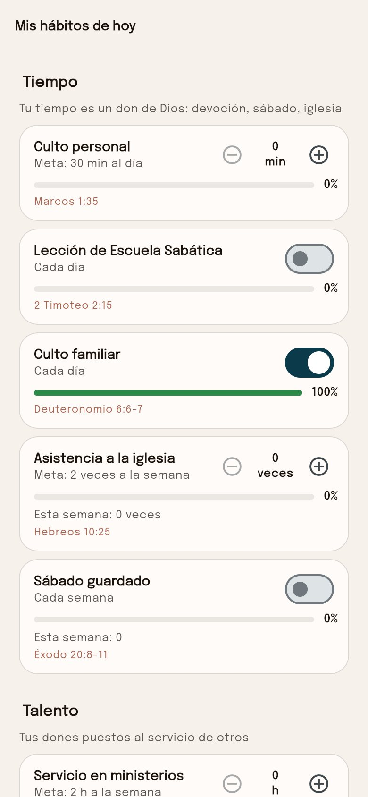<figcaption>Mis hábitos de hoy</figcaption></figure><figure>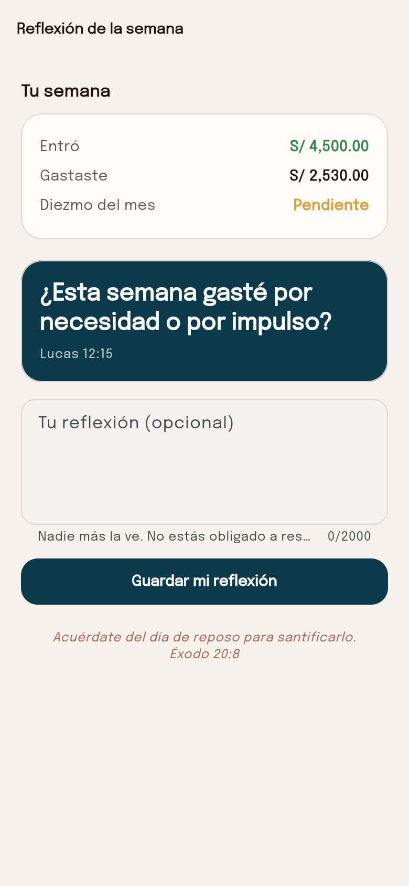<figcaption>Reflexión de la semana</figcaption></figure>

### Modo Sábado
Entre el **viernes al atardecer (18:00) y el sábado al atardecer (18:00)** la app **no te envía avisos de gastos** (como «te pasaste del presupuesto»): se guardan y llegan al terminar el sábado. Puedes anotar movimientos si lo necesitas; solo se evita promover el consumo. Se puede desactivar en **Perfil → Mayordomía**.

## 10. Avisos (la campana)

La **campana** muestra un número rojo con tus avisos sin leer. Toca un aviso para ir a la pantalla relacionada (un recordatorio de diezmo te lleva a *Diezmos*). **Marcar todas** los deja como leídos. Los avisos están **dentro de la app** (no llegan como notificaciones del sistema).

<figure>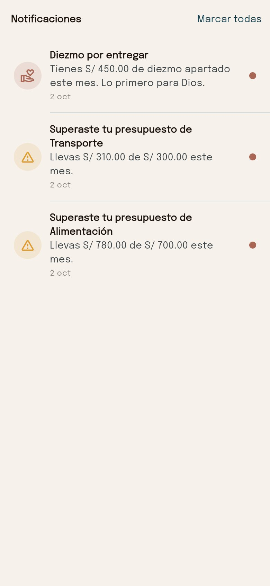<figcaption>Bandeja de avisos</figcaption></figure>

## 11. Perfil y privacidad

Toca tu **inicial** (arriba a la derecha) → **Perfil y configuración**.

<figure>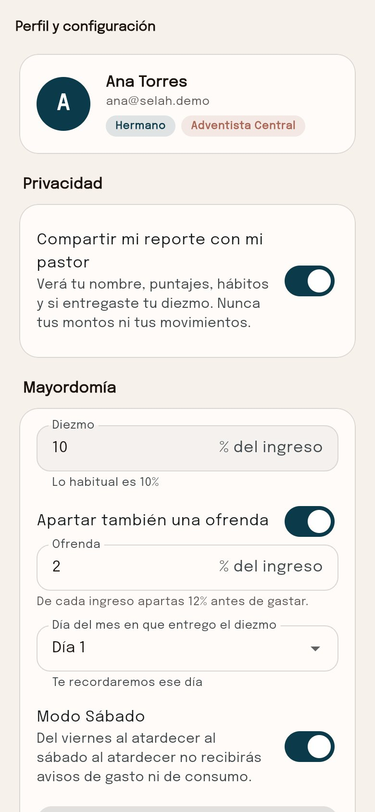<figcaption>Perfil y privacidad</figcaption></figure><figure>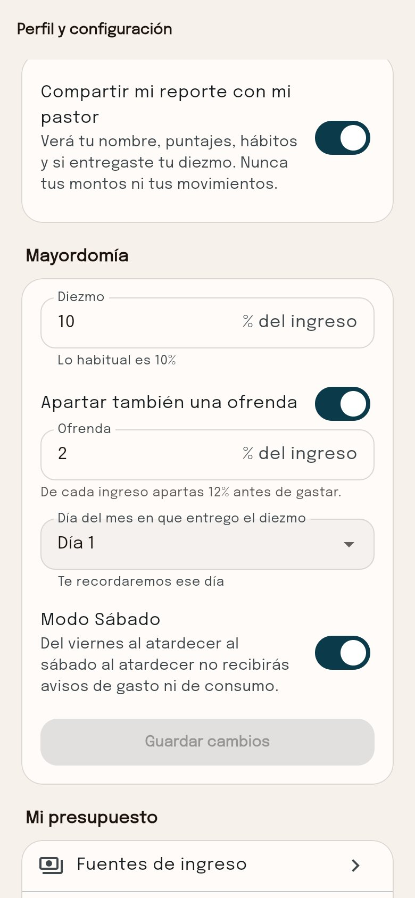<figcaption>Mayordomía y presupuesto</figcaption></figure><figure>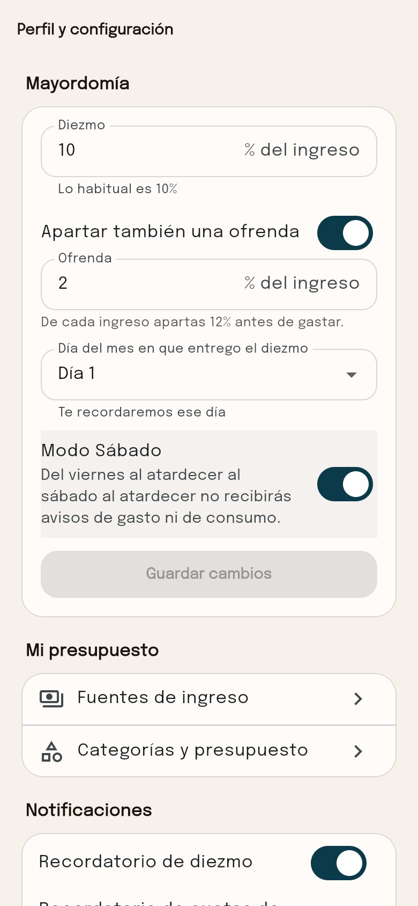<figcaption>Notificaciones y seguridad</figcaption></figure>

- **Privacidad:** el interruptor **«Compartir mi reporte con mi pastor»** (solo hermanos).
- **Mayordomía:** porcentajes de diezmo y ofrenda, día de entrega y Modo Sábado. Se guardan con **Guardar cambios**.
- **Mi presupuesto:** **Fuentes de ingreso** y **Categorías y presupuesto**.
- **Notificaciones:** qué recordatorios quieres recibir.
- **Mi vida espiritual:** **Mis hábitos de hoy** y **Reflexión de la semana**.
- **Seguridad:** **Cambiar contraseña** y **Cerrar sesión**.

<figure>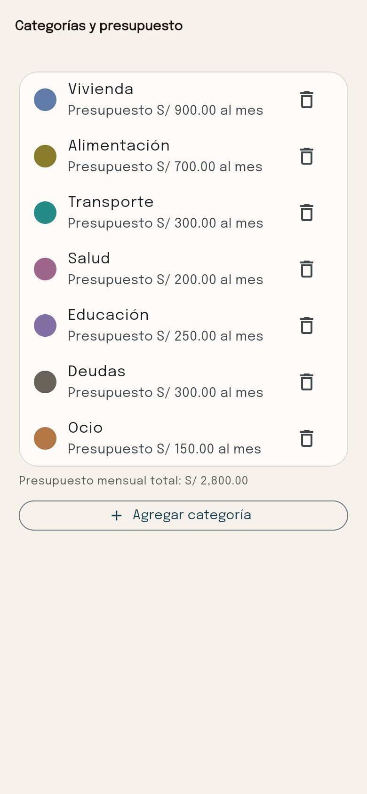<figcaption>Categorías y presupuesto</figcaption></figure><figure>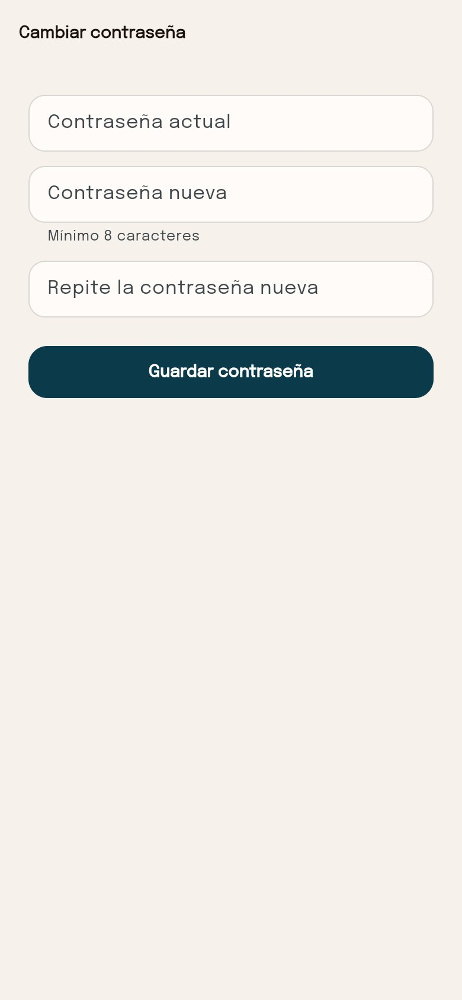<figcaption>Cambiar contraseña</figcaption></figure>

### ¿Qué ve tu pastor? Tú decides
Tu información financiera es **tuya**. Por defecto **nadie** la ve: ni el pastor ni el administrador.

| Quién | Qué puede ver |
|---|---|
| **Administrador** | Solo gestiona cuentas e iglesias. **Nunca ve montos, movimientos ni reportes.** |
| **Pastor** (si **no** compartes) | Solo **totales anónimos** de toda la congregación (cuántos hermanos hay, qué porcentaje tiene el diezmo al día, promedios de las cuatro áreas), **sin nombres ni dinero**. |
| **Pastor** (si **sí** compartes) | Tu **nombre**, tus puntajes 4T, tu semáforo, tus hábitos y **si cumpliste el diezmo (sí/no)**. **Nunca tus montos ni tus movimientos.** |

Activa o desactiva el interruptor cuando quieras; el cambio es inmediato. Para que los promedios de la congregación se muestren, deben existir **al menos 3 hermanos con datos**, así nadie queda identificado.

---

# Parte C · Pastor

El pastor tiene **sus propias finanzas** como cualquier hermano (Parte B) y **además** una vista de su iglesia. Su pantalla de Inicio es igual a la del hermano, con un ícono extra arriba.

## 12. Mi congregación

1. En la barra de arriba, toca el **ícono de personas** (*Mi congregación*).
2. Cambia de mes con **‹ ›**.

<figure>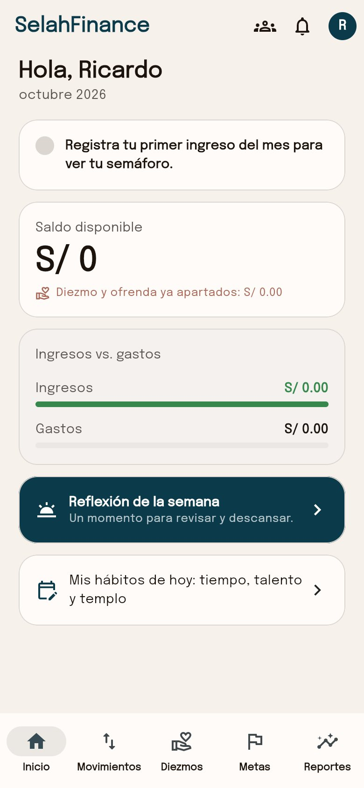<figcaption>Inicio del pastor: ícono de congregación arriba</figcaption></figure><figure>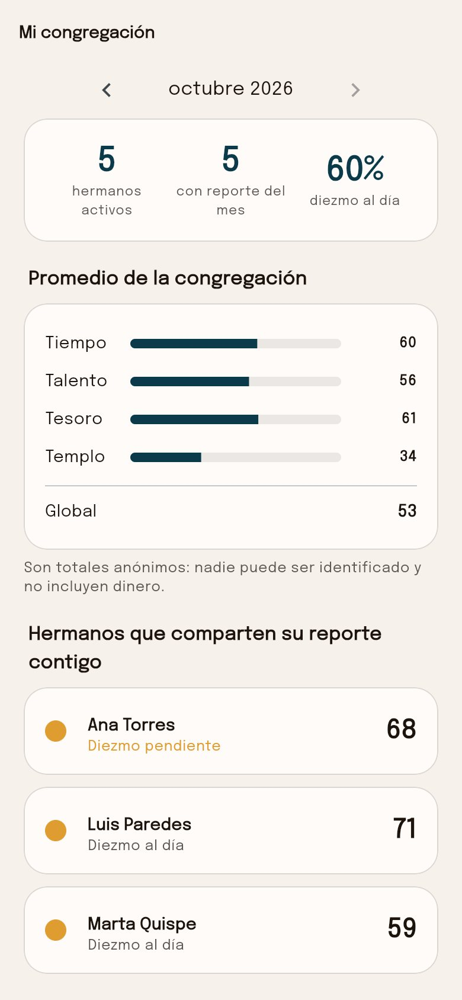<figcaption>Totales anónimos de la congregación</figcaption></figure><figure>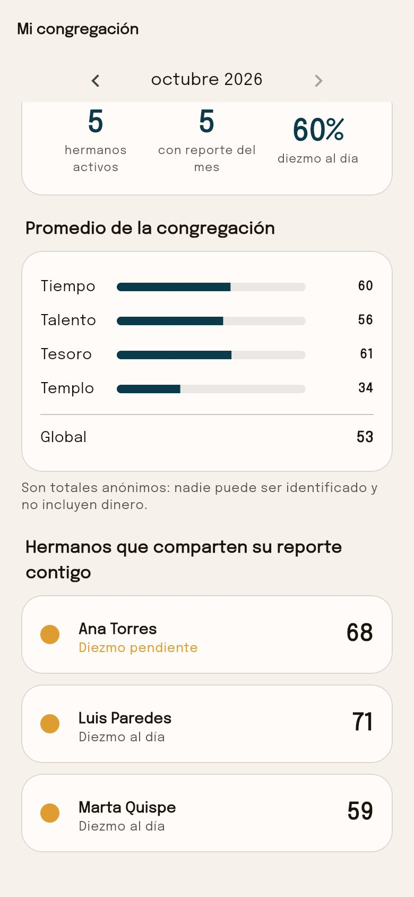<figcaption>Hermanos que comparten su reporte</figcaption></figure>

**Totales anónimos.** Hermanos activos, cuántos tienen reporte del mes y **qué porcentaje tiene el diezmo al día**, más el promedio de la congregación en Tiempo, Talento, Tesoro y Templo. *Son totales anónimos: nadie puede ser identificado y no incluyen dinero.* Si hay menos de 3 hermanos con datos, los promedios no se muestran.

**Hermanos que comparten su reporte contigo.** Solo aparecen quienes activaron *«Compartir mi reporte con mi pastor»*. Toca un nombre para ver su semáforo, sus puntajes y sus hábitos, y si entregó su diezmo (*sí/no*). **Nunca se muestran montos.** Si un hermano deja de compartir, desaparece de tu lista.

<figure>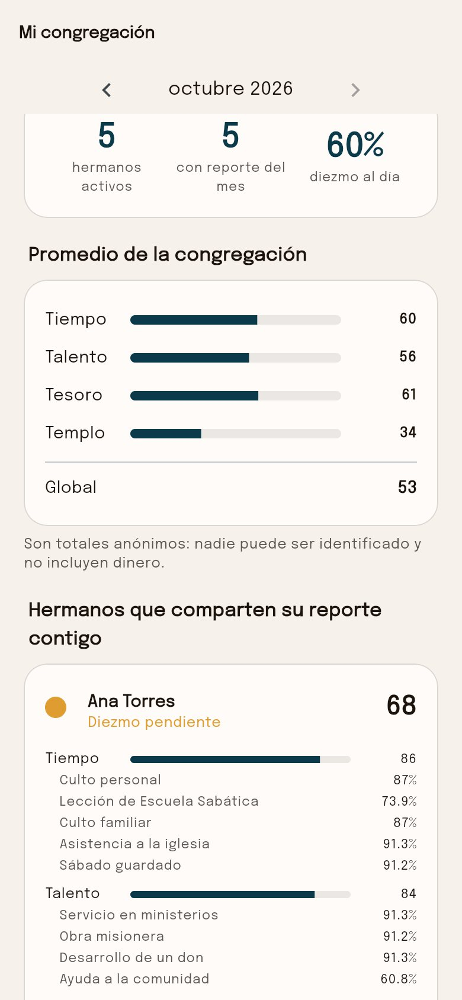<figcaption>Reporte de un hermano que decidió compartirlo</figcaption></figure>

> **Uso pastoral responsable:** esta información sirve para **acompañar y orar**, no para juzgar ni comparar a las personas.

---

# Parte D · Administrador

El administrador **cuida las cuentas, no el dinero**: no tiene finanzas propias, no pasa por el asistente de configuración y no puede ver las de nadie. Su app tiene cuatro pestañas: **Resumen, Usuarios, Iglesias e Integraciones**.

## 13. Panel de administración

### Resumen
Cuántas cuentas hay, cuántas están bloqueadas y cuántas por rol. Para cambiar tu contraseña o cerrar sesión, usa el **ícono de arriba a la derecha**.

<figure>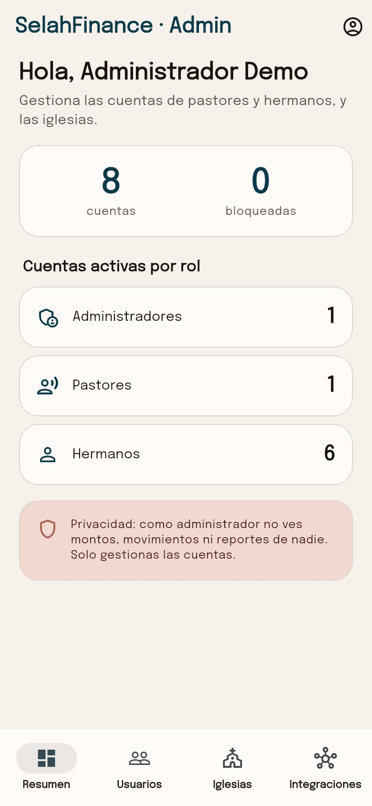<figcaption>Resumen de cuentas por rol</figcaption></figure><figure>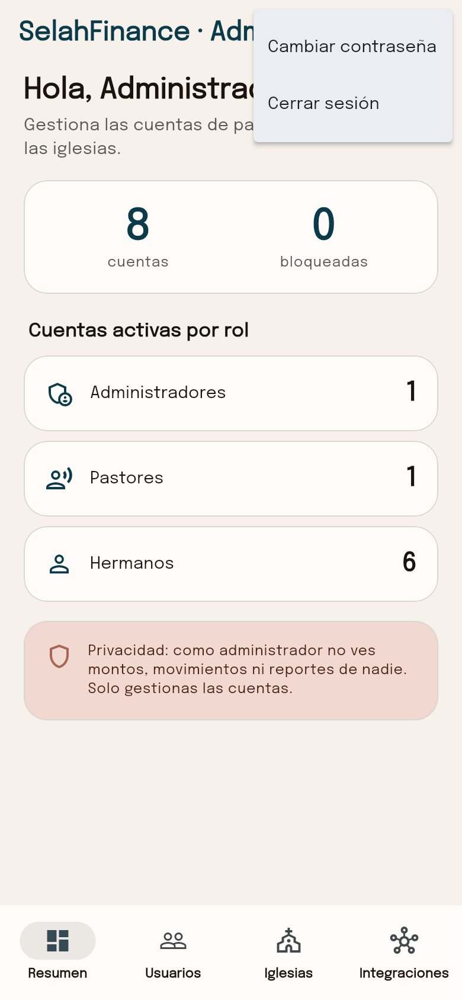<figcaption>Menú: cambiar contraseña y cerrar sesión</figcaption></figure>

### Usuarios
- **Buscar** por nombre o email y **filtrar** por rol o por cuentas bloqueadas.
- Toca una cuenta para ver sus acciones: **Editar datos, iglesia o rol**, **Restablecer contraseña** (genera una temporal nueva) y **Bloquear cuenta** (o **Reactivar cuenta**).
- **Bloquear** saca a la persona de la app **al instante**, aunque tenga la sesión abierta. Cambiar el rol de alguien también le cierra sus sesiones.

<figure>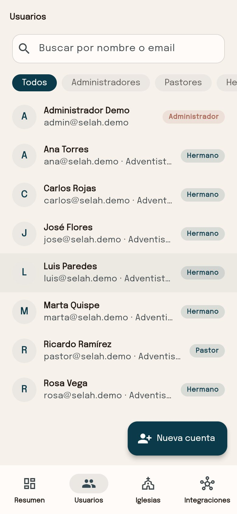<figcaption>Lista de cuentas</figcaption></figure><figure>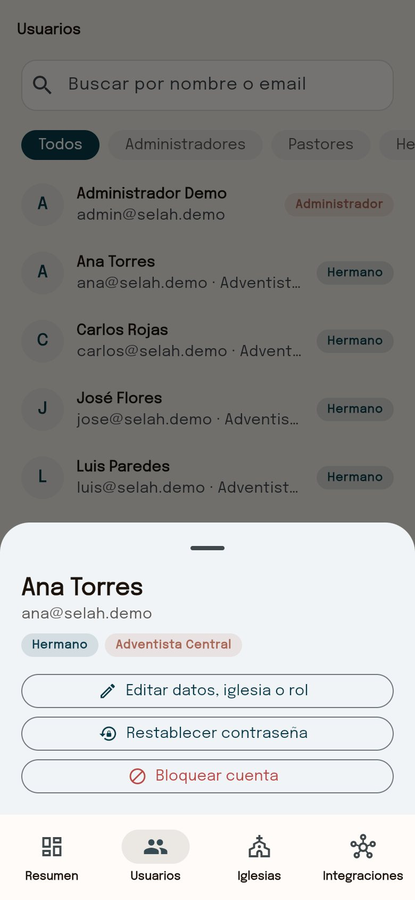<figcaption>Acciones sobre una cuenta</figcaption></figure>

### Crear una cuenta (pastor u otro)
1. Toca **Nueva cuenta**.
2. Elige el **rol** (Administrador, Pastor o Hermano), escribe nombre, apellidos (opcional) y email, y elige la **iglesia**.
3. La app genera una **contraseña temporal** (puedes pulsar el ícono de recarga para generar otra).
4. Toca **Crear cuenta**. Aparece un aviso con la contraseña: **se muestra una sola vez**. Toca **Copiar**, entrégala a la persona y pulsa **Ya lo guardé**. Ella deberá cambiarla en su primer ingreso.

<figure>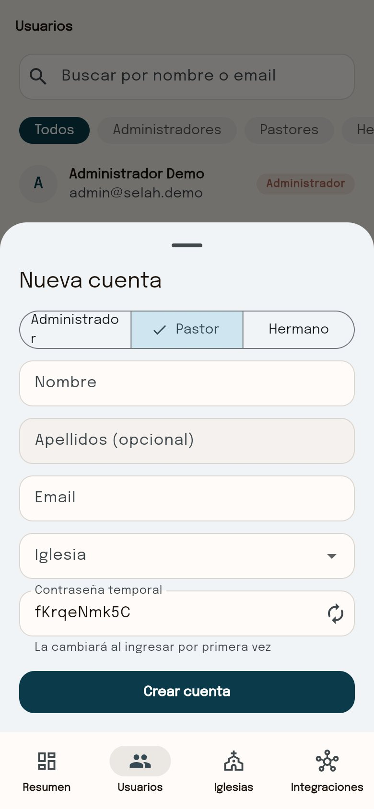<figcaption>Nueva cuenta</figcaption></figure><figure>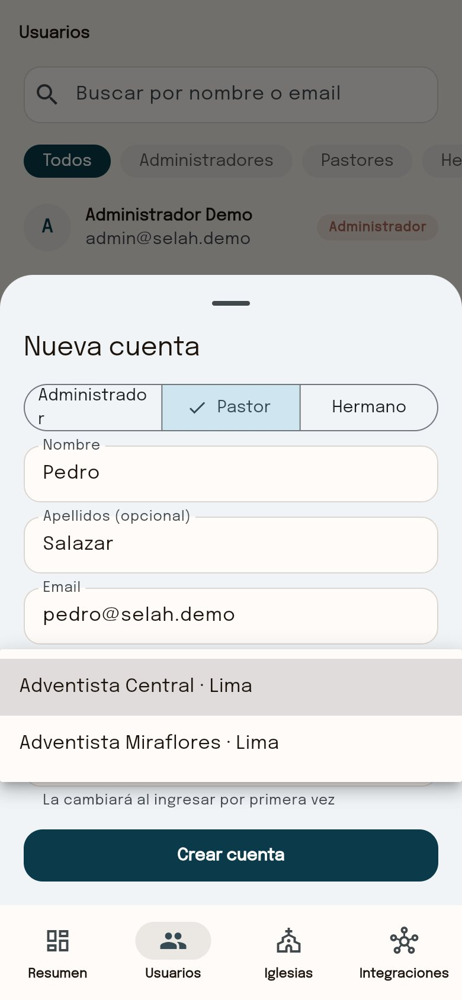<figcaption>Elegir la iglesia</figcaption></figure><figure>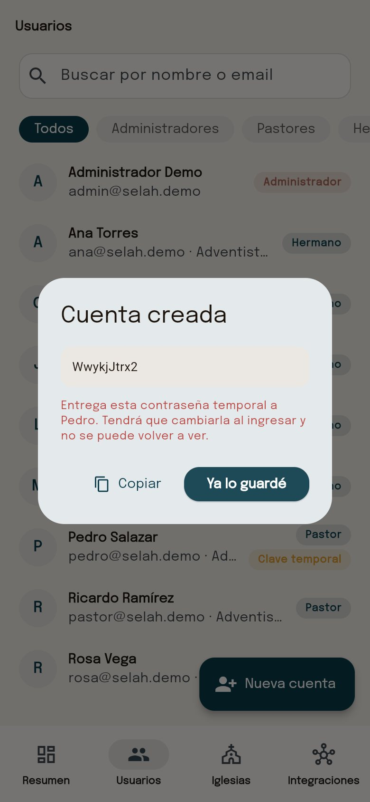<figcaption>Contraseña temporal (una sola vez)</figcaption></figure>

### Iglesias
- **Nueva iglesia** (nombre, ciudad y distrito) y editar las existentes.
- **Activa:** si la desactivas, deja de aparecer en el registro (quienes ya pertenecen siguen).
- **Importante:** si no hay ninguna iglesia, **nadie podrá registrarse**.

<figure>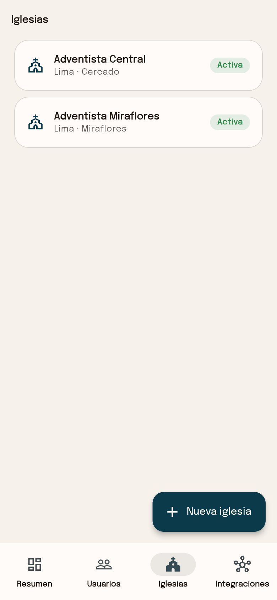<figcaption>Lista de iglesias</figcaption></figure><figure>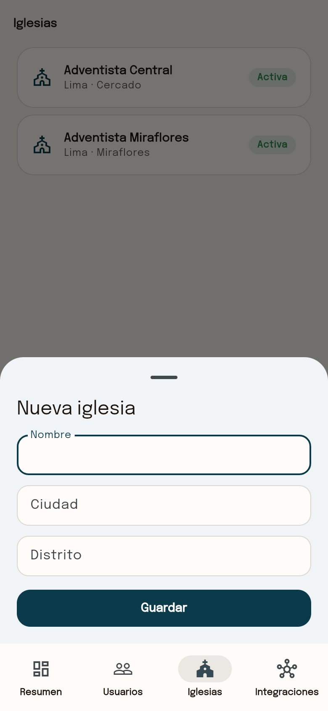<figcaption>Crear una iglesia</figcaption></figure>

### Integraciones (para el equipo técnico)
Aquí se da acceso a sistemas de otros equipos.

- **Conectar un sistema** crea una **clave de acceso (API key)** con los permisos que elijas y una vigencia (sin vencimiento, 30 días, 90 días o 1 año).
- **Webhooks** son avisos automáticos que la app envía a una dirección web cuando ocurre algo (por ejemplo, un movimiento registrado), firmados para que el receptor pueda comprobar que vienen de SelahFinance.
- La clave y el secreto **se muestran una sola vez**: guárdalos en un lugar seguro. Puedes **Revocar** una clave o **Eliminar** un webhook cuando ya no se necesite.

<figure>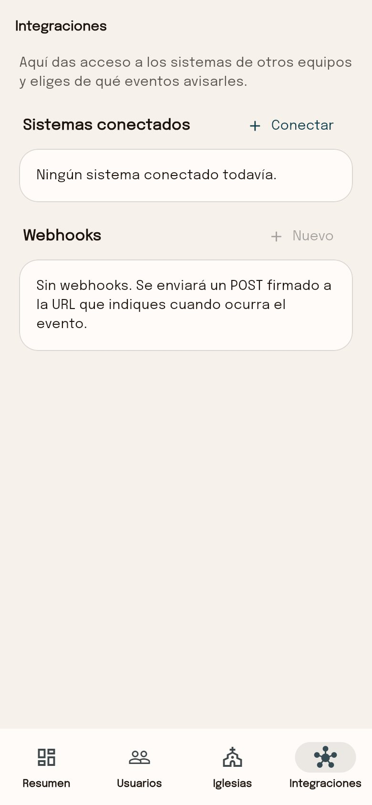<figcaption>Sistemas conectados y webhooks</figcaption></figure><figure>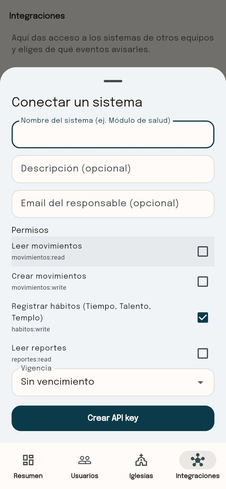<figcaption>Conectar un sistema</figcaption></figure>

Si no trabajas con otros equipos, puedes ignorar esta pestaña.

### Buenas prácticas del administrador
- Entrega las contraseñas temporales **en persona o por un medio seguro**, nunca en grupos de chat.
- Crea las iglesias **antes** de invitar a los hermanos.
- Bloquea las cuentas de quien ya no participa; no las borres.
- Recuerda: no puedes ver los montos ni los reportes de nadie, y eso es a propósito.

---

# Parte E · Ayuda

## 14. Preguntas frecuentes

**No puedo ingresar.** Revisa el email (sin espacios) y la contraseña (distingue mayúsculas). Si la olvidaste, pide una temporal al administrador.

**Dice «No se pudo conectar» o se queda cargando.** Verifica tu internet. Si el servidor estuvo sin uso, puede tardar hasta un minuto; espera y vuelve a intentar. Si persiste, avisa al equipo.

**Mi iglesia no aparece al registrarme.** El administrador debe crearla en la pestaña *Iglesias*.

**Me equivoqué en un monto.** Abre el movimiento en *Movimientos* y **elimínalo**; luego regístralo correcto.

**¿Por qué mi saldo es menor que lo que ingresé?** Porque el diezmo y la ofrenda ya están apartados. Puedes ajustar los porcentajes en *Perfil → Mayordomía*.

**Entregué mi diezmo y sigue como pendiente.** En *Diezmos* toca **Marcar como entregado**.

**No recibo avisos de «presupuesto excedido» el viernes en la noche.** Es el **Modo Sábado**: se guardan y llegan cuando termina el sábado.

**Mi reporte 4T está en rojo.** Es una **guía, no una calificación**. Mira qué área tiene menos puntaje y qué hábitos la componen; empieza por uno pequeño.

**¿Quién puede ver mi dinero?** Nadie más que tú. El pastor ve únicamente lo que tú decidas compartir (sin montos) y el administrador nada de tus finanzas.

**Me cerró la sesión sola.** Por seguridad la sesión caduca después de unas horas. Vuelve a entrar con tu email y contraseña; tus datos no se pierden.

**Cambié de celular. ¿Pierdo mis datos?** No. Tus datos están en el servidor: instala la app en el nuevo teléfono y entra con tu cuenta.

**¿Hay versión para iPhone?** Por ahora solo Android.

## 15. Pequeño diccionario

| Palabra | Significa |
|---|---|
| **Mayordomía** | Cuidar con responsabilidad todo lo que Dios nos confió: tiempo, talentos, dinero y salud. |
| **4T** | Tiempo, Talento, Tesoro y Templo: las cuatro áreas del reporte. |
| **Diezmo** | La décima parte de tus ingresos, que se aparta para Dios. |
| **Ofrenda** | Lo que entregas además del diezmo, de manera voluntaria. |
| **Primicias** | «Lo primero es para Dios»: se aparta el diezmo antes de repartir el resto. |
| **Saldo disponible** | Lo que puedes gastar después de apartar diezmo y ofrenda. |
| **Presupuesto** | Cuánto planeas gastar en cada categoría al mes. |
| **Semáforo** | Color que resume qué tan sano está tu gasto frente a tus ingresos. |
| **Meta de ahorro** | Algo para lo que guardas dinero, con monto objetivo. |
| **Interés** | Lo que cobra el banco por prestarte dinero; en cada pago se cubre primero. |
| **Hábito** | Una práctica diaria o semanal que cuidas (orar, caminar, tomar agua…). |
| **Modo Sábado** | Pausa de avisos de consumo entre el viernes y el sábado al atardecer. |
| **Contraseña temporal** | Clave de un solo uso que da el administrador; hay que cambiarla al entrar. |
| **APK** | El archivo de instalación de una app Android fuera de la tienda oficial. |

*¿Dudas o sugerencias? Escribe al equipo de SelahFinance que te compartió la aplicación.*
